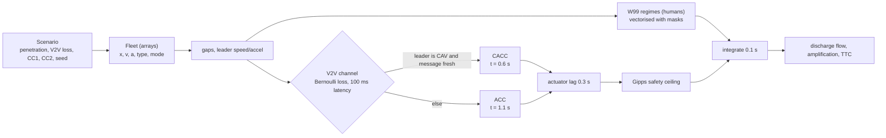
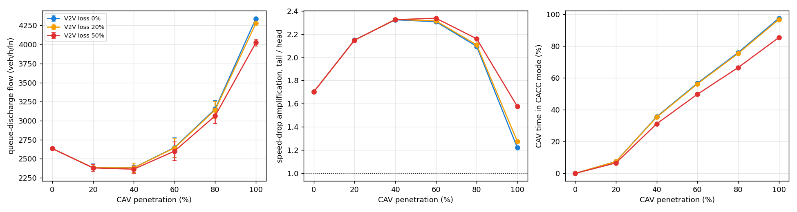
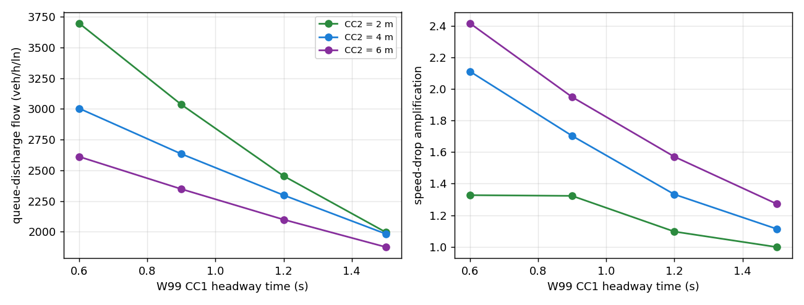

# cav-fleet-platoon-simulator

**What happens to freeway capacity as automated vehicles arrive?** A vectorised single-lane
mixed-autonomy simulator: human drivers follow a **Wiedemann 99** re-implementation (Vissim's freeway
model, CC0-CC9); automated vehicles run the **PATH ACC and CACC** controllers with V2V packet loss,
fallback to ACC, actuator lag and a Gipps safety ceiling. Experiments measure queue-discharge capacity,
string stability and TTC across 0-100% penetration.

**Headline (280 runs, 10 seeds each, 0 collisions):**

* **Capacity is U-shaped in penetration.** It **falls 10%** at 20-40% CAVs (2,634 → 2,382 vph), breaks even
  near 60%, and reaches **+65%** (4,339 vph) only at 100% CACC.
* **CC2 matters as much as CC1.** In W99, CC2 (following variation) moves capacity as much as CC1
  (headway): at CC1 = 0.9 s, CC2 = 2 → 6 m drops discharge flow from 3,036 to 2,348 vph.

---

## 1. Problem formulation

Agencies are asked to plan for connected and automated vehicles, and Vissim models are increasingly used
to answer "what does X% CAV do to capacity?". The answer depends on three things that are easy to get wrong:

1. **Who follows whom.** CACC needs a *connected* leader. At penetration $p$ with random mixing, only
   about $p^2$ of vehicle pairs can platoon; the rest fall back to ACC.
2. **ACC is not CACC.** Production-style ACC uses longer gaps (about 1.1 s) and is known to be string-unstable.
3. **Human-driver calibration.** The W99 parameters behind every Vissim baseline set the reference that
   CAV gains are measured against.

| Bar | Here |
|---|---|
| **Traffic engineering** | W99 with Vissim parameter semantics, queue-discharge capacity, string stability, TTC, CC1/CC2 sensitivity |
| **ML / multi-agent** | Heterogeneous agents (W99 humans, ACC, CACC), V2V channel with loss, mode switching, 10-seed replication |
| **Systems** | Fully vectorised per-step update over all agents (NumPy masks for W99's four regimes), process-pool sweep, FastAPI experiment endpoint |

---

## 2. Architecture



---

## 3. Methodology

**Wiedemann 99.** With $dv = v_{lead} - v$ and net gap $dx$:

$$SDX_c = CC0 + CC1\,v_{slower},\quad SDX_o = SDX_c + CC2,\quad SDX_v = SDX_o + CC3\,(dv - CC4)$$
$$SDV = CC6\,dx^2/10^4,\quad CLDV = CC4 - SDV,\quad OPDV = CC5 + SDV$$

Four regimes, following the pseudocode of Higgs, Abbas & Medina (2011): decelerate to increase distance
($dx \le SDX_c$), decelerate while approaching ($dv < CLDV$, $dx < SDX_v$), following (oscillate at ±CC7), and
free (CC8 → CC9 interpolated over 0-80 km/h). Defaults are Vissim's freeway values (CC0 = 1.5 m, CC1 = 0.9 s,
CC2 = 4 m, ...). **This is a re-implementation, not Vissim's code**: regimes and parameter roles match, but
trajectories are not bit-identical.

**ACC / CACC** (Milanés & Shladover 2014 gains, field-tested at PATH):

$$\text{ACC: } a = 0.23\,(dx - 2 - 1.1v) + 0.07\,(v_l - v),\qquad
\text{CACC: } v_{k} = v_{k-1} + 0.45\,e_k + 0.25\,\dot e_k,\ \ e = dx - 2 - 0.6v$$

The CACC law runs in the discrete per-step form used with these gains in Aimsun studies (Liu, Kan &
Shladover 2018). CACC needs a message from a CAV leader. Messages are lost with probability $p_{loss}$ and
arrive one step late; after 3 consecutive losses, or behind a human driver, the vehicle uses ACC. Automated
vehicles also get a 0.3-s first-order actuator lag and a Gipps safe-speed ceiling ($b$ = 6 m/s²).

**Experiments.**

* *Queue discharge*: 60 stopped vehicles released; saturation flow from headways at a detector 150 m downstream, skipping the first 10.
* *Perturbation*: 40 vehicles at 25 m/s; the head brakes to 15 m/s at 3 m/s², holds 10 s, then recovers.
  Amplification = speed drop of the last 5 vehicles / head's drop (> 1 means string-unstable); min TTC over the string.

---

## 4. Results ([`results/mixed_autonomy/RESULTS.md`](results/mixed_autonomy/RESULTS.md))



| CAV share | V2V loss | Discharge flow (veh/h/ln) | Amplification | Time in CACC |
|---|---|---|---|---|
| 0% | - | 2,634 ± 17 | 1.70 | 0% |
| 20% | 0% | 2,382 ± 48 (**−10%**) | 2.15 | 8% |
| 40% | 0% | 2,383 ± 61 (−10%) | 2.32 | 36% |
| 60% | 0% | 2,647 ± 130 (±0%) | 2.31 | 57% |
| 80% | 0% | 3,153 ± 111 (+20%) | 2.09 | 76% |
| **100%** | 0% | **4,339 ± 6 (+65%)** | **1.22** | 98% |
| 100% | 50% | 4,025 ± 45 (+53%) | 1.58 | 85% |

**Engineering reading.**

* **Low penetration hurts.** At 20-40%, most CAVs follow a human, run ACC at 1.1 s, and are slower to close
  gaps than W99 humans at CC1 = 0.9 s. They also amplify disturbances more (2.15-2.32 vs 1.70).
  This matches field and simulation findings that ACC alone does not add capacity.
* **The gains come from platoons, not automation.** Time in CACC grows roughly with the share of CAV-behind-CAV
  pairs, and capacity follows it.
* **V2V loss matters only once platoons exist.** 50% loss is invisible at 20% penetration but costs 7% of
  capacity and raises amplification from 1.22 to 1.58 at 100%.
* **Even full CACC is not perfectly string-stable here (1.22).** The 0.3-s actuator lag erodes the margin,
  which is a known effect.
* **Safety:** 0 collisions in 280 runs; the minimum TTC over the string is lowest in mid-penetration mixes (1.4-2.0 s).

### W99 sensitivity (all human)



| CC1 \ CC2 | 2 m | 4 m | 6 m |
|---|---|---|---|
| 0.6 s | 3,698 | 3,005 | 2,611 |
| 0.9 s | 3,036 | **2,634** | 2,348 |
| 1.2 s | 2,454 | 2,298 | 2,099 |
| 1.5 s | 1,996 | 1,982 | 1,875 |

Discharge flow (veh/h/ln). CC2 shifts capacity by up to 1,000 vph at short headways, and larger CC2 also
increases string amplification (1.32 → 1.95 at CC1 = 0.9 s). **For Vissim calibration: CC1 and CC2 must
be tuned together against observed capacity *and* stability.**

---

## 5. Layout, reproduce, limitations

```
src/platoon/models.py   W99 (vectorised regimes), ACC, CACC, Gipps safety ceiling
src/platoon/sim.py      fleet arrays, V2V channel, queue-discharge and perturbation experiments
src/platoon/study.py    process-pool sweep, report, figures ; api/app.py ; cli.py
tests/ (7 tests: W99 regimes, equilibria, CC1 monotonicity, CACC capacity/stability, loss effect, API)
```

```bash
python -m venv .venv && .venv/Scripts/activate
pip install -r requirements.txt && pip install --no-deps -e .
pytest && platoon study --seeds 10 --workers 2
```

**Limitations.** Single lane (no lane changes or merging, so platoon formation through lane choice is not
modelled); random CAV placement; W99 re-implemented from published pseudocode, not Vissim's DLL; and
independent packet loss rather than bursty loss.

## License

MIT
