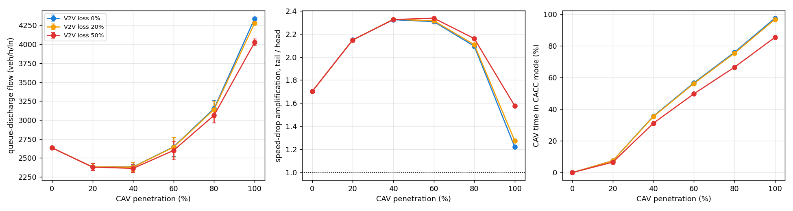
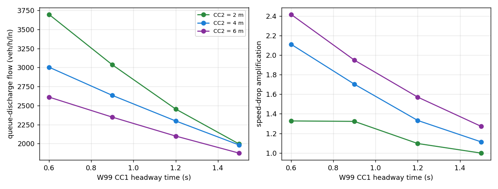

# Mixed-autonomy results

280 runs (10 seeds per cell) in 162 s; collisions across all runs: 0.

## Penetration x V2V loss

| CAV % | V2V loss | Discharge flow (veh/h/ln) | Amplification | Tail decel (m/s²) | Min TTC (s) | Vehicles with TTC < 1.5 s | Time in CACC |
|---|---|---|---|---|---|---|---|
| 0% | 0% | 2634 ± 17 | 1.70 | 2.17 | 6.38 | 0.0% | 0% |
| 20% | 0% | 2382 ± 48 | 2.15 | 3.09 | 2.45 | 0.0% | 8% |
| 40% | 0% | 2383 ± 61 | 2.32 | 3.68 | 1.99 | 0.0% | 36% |
| 60% | 0% | 2647 ± 130 | 2.31 | 3.59 | 1.49 | 0.3% | 57% |
| 80% | 0% | 3153 ± 111 | 2.09 | 3.36 | 2.47 | 0.0% | 76% |
| 100% | 0% | 4339 ± 6 | 1.22 | 2.36 | 6.13 | 0.0% | 98% |
| 20% | 20% | 2382 ± 48 | 2.15 | 3.10 | 2.45 | 0.0% | 7% |
| 40% | 20% | 2380 ± 61 | 2.33 | 3.79 | 1.97 | 0.0% | 35% |
| 60% | 20% | 2642 ± 128 | 2.31 | 3.79 | 1.71 | 0.0% | 56% |
| 80% | 20% | 3141 ± 109 | 2.11 | 3.37 | 2.69 | 0.0% | 75% |
| 100% | 20% | 4279 ± 18 | 1.27 | 2.65 | 5.93 | 0.0% | 97% |
| 20% | 50% | 2379 ± 45 | 2.15 | 3.15 | 2.45 | 0.0% | 7% |
| 40% | 50% | 2363 ± 55 | 2.32 | 3.96 | 1.84 | 0.0% | 31% |
| 60% | 50% | 2600 ± 124 | 2.34 | 4.16 | 1.39 | 0.3% | 50% |
| 80% | 50% | 3064 ± 103 | 2.16 | 3.93 | 2.06 | 0.0% | 66% |
| 100% | 50% | 4025 ± 45 | 1.58 | 3.80 | 3.89 | 0.0% | 85% |

## W99 sensitivity (all human, 0% CAV)

| CC1 (s) | CC2 (m) | Discharge flow (veh/h/ln) | Amplification | Min TTC (s) |
|---|---|---|---|---|
| 0.6 | 2 | 3698 ± 26 | 1.33 | 2.90 |
| 0.6 | 4 | 3005 ± 16 | 2.11 | 2.32 |
| 0.6 | 6 | 2611 ± 11 | 2.42 | 1.43 |
| 0.9 | 2 | 3036 ± 16 | 1.32 | 6.87 |
| 0.9 | 4 | 2634 ± 17 | 1.70 | 6.38 |
| 0.9 | 6 | 2348 ± 10 | 1.95 | 4.99 |
| 1.2 | 2 | 2454 ± 8 | 1.10 | 6.54 |
| 1.2 | 4 | 2298 ± 13 | 1.33 | 6.94 |
| 1.2 | 6 | 2099 ± 9 | 1.57 | 6.46 |
| 1.5 | 2 | 1996 ± 3 | 1.00 | 7.21 |
| 1.5 | 4 | 1982 ± 6 | 1.11 | 6.74 |
| 1.5 | 6 | 1875 ± 5 | 1.27 | 5.54 |

